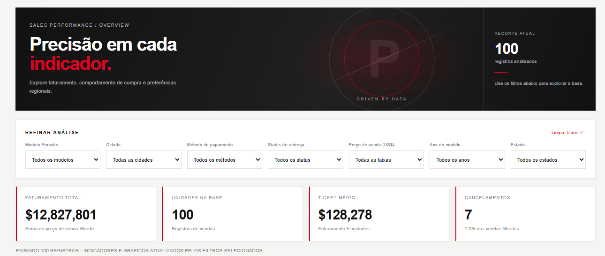
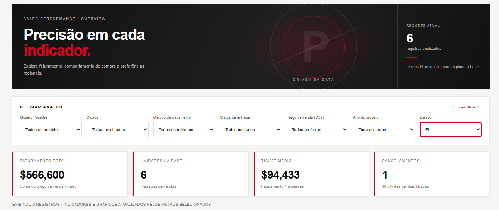

# Dashboard de Vendas Porsche

Dashboard interativo de vendas de modelos Porsche, gerado com IA e publicado no GitHub Pages.

🔗 **Dashboard publicada:** https://melissayakushijin-oss.github.io/dashboard_porsche/



---

## 1. Perguntas de negócio

Escolhi quatro perguntas que um gestor comercial faria para decidir onde investir esforço de vendas e onde há risco de perder receita:

| Pergunta | Onde aparece | Por que importa |
|---|---|---|
| Quais cidades geram mais faturamento? | Gráfico "Cidades com maior faturamento" | Mostra as praças prioritárias para estoque, eventos e equipe de vendas. |
| Quais métodos de pagamento concentram mais cancelamentos? | Gráfico "Cancelamentos por pagamento" | Cancelamento é receita perdida. Saber o método ajuda a revisar regras de aprovação e crédito. |
| Qual ano de modelo vende mais em cada cidade? | Tabela "Ano de modelo mais vendido por cidade" | Orienta a distribuição de estoque de modelos novos e seminovos por região. |
| Qual modelo lidera em cada estado? | Tabela "Modelos líderes por estado" | Revela preferências regionais para campanhas de marketing direcionadas. |

Além dessas, a dashboard traz indicadores gerais (faturamento total, unidades, ticket médio e taxa de cancelamento), o mix de modelos e seis insights automáticos.

## 2. Prompt utilizado

Prompt inicial, enviado ao ChatGPT junto com a base tratada:

```text
utilizando o recurso de canvas, renderize uma dashboard em html ao lado

#Filtros

* Modelo da Porshe
* Cidade
* Método de Pagamento
* Delivery Status
* Sales Price
* Model year
* State


#Perguntas de negócios e KPIs
-> Quais cidades tiveram o maior faturamento?
-> Quais métodos de pagamento tiveram mais compras canceladas?
-> Quais os anos dos modelos que mais sairam por cidade?
-> Quero insights de carros mais vendidos por estados

Sobre o ui/ux, se baseie no site oficial da porshe brasil:
https://www.porsche.com/brazil/pt/

Tenha um ar profissional e minimalista

Sempre use as colunas Sanitized
```

O prompt já definia os filtros, as perguntas de negócio, a referência visual (site oficial da Porsche Brasil) e a regra de usar só as colunas tratadas ("Sanitized").

### O que mudou até a versão final

1. **Primeira versão:** filtros, indicadores, gráficos de barras, tabelas por cidade e estado e insights automáticos, com layout simples.
2. **Refinamento de design:** hierarquia de títulos mais forte, contraste mais contido e cartões com sombras leves, para chegar mais perto do visual minimalista da referência.
3. **Camada visual:** faixa de destaque escura no topo e gráfico de rosca com o mix de modelos.
4. **Revisão e correção de erros** (feita com o Claude):
   - o gráfico de rosca calculava o total e os percentuais só sobre os 8 maiores modelos. Passou a agrupar o restante em "Outros", para somar 100%;
   - os valores no fim das barras saíam do gráfico. Foi reservado espaço para eles;
   - empates no "líder" passaram a ter critério fixo;
   - gráficos e tabelas vazios passaram a mostrar mensagem;
   - rótulos traduzidos para português e percentuais padronizados com vírgula.

## 3. Tratamento da base

A base original ("BASE SANITIZED PORSCHE", aba "Sanitized") passou pelos seguintes tratamentos antes de ir para a IA:

- **Remoção das colunas sem tratamento:** apaguei todas as colunas que não tinham o sufixo "Sanitized". Ficaram só as versões tratadas dos dados.
- **Formatação de valores:** mantive as colunas de valores formatadas como moeda.
- **Sem dados sensíveis:** as colunas que ficaram (modelo, cidade, estado, método de pagamento, status de entrega, preço de venda e ano do modelo) não identificam clientes. Isso importa porque a base fica embutida no HTML, e o HTML é público.

## 4. Ferramenta utilizada

**ChatGPT com Canvas.** O recurso de Canvas renderizou a dashboard em HTML ao lado da conversa, o que permitiu ver o resultado e pedir ajustes a cada versão. Na etapa final, usei o Claude para revisar o código e corrigir erros antes de publicar.

## 5. Exemplo de filtro aplicado

Com o filtro **Estado = FL**, a dashboard recalcula tudo: 6 vendas, faturamento de US$ 566.600, ticket médio de US$ 94.433 e 1 cancelamento.



## Funcionalidades

- 7 filtros combináveis: modelo, cidade, método de pagamento, status de entrega, faixa de preço, ano do modelo e estado
- 4 indicadores: faturamento total, unidades, ticket médio e cancelamentos
- Gráficos de barras e de rosca desenhados com Canvas, sem bibliotecas externas
- Tabelas por cidade e por estado
- Insights automáticos
- Layout responsivo (computador, tablet e celular)

## Tecnologias

HTML, CSS e JavaScript puro, em um único arquivo (`index.html`).

## Como executar localmente

Baixe o repositório e abra o `index.html` no navegador. Não é preciso instalar nada.

## Aviso

Projeto acadêmico, sem vínculo com a Porsche AG.

## Autora

**Melissa Rojas Yakushijin** · [GitHub](https://github.com/melissayakushijin-oss)
